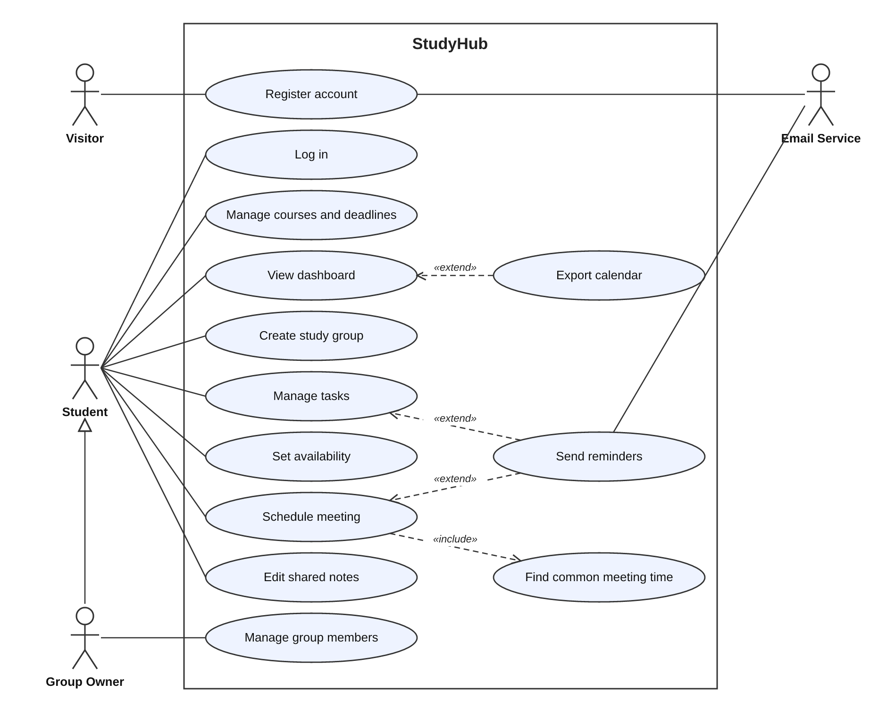

# Week 4: From Use Case Diagram to Use Case Specification

*By Ergens Hyso, Kristine Megrelishvili and Antonio Kanani.*

## Where we are on the road

So far our project went like this:

1. **Vision:** group projects are chaotic, so we put courses, deadlines, tasks, meetings and notes into one app.  
2. **Overall use case diagram:** the circles and stick figures that show *who* can do *what*.  
3. **SRS:** the requirements document, where we chose the scope for this semester.

The diagram has a weakness. Take **Log in**: all we did was draw a circle, name it, and say a registered student can use it. We don't yet know *how* it works. The use case specification is the next step, where we drill deeper.

## The "throw it over the wall" test

Our lecturer gave us a mental test. Imagine your development team sits in another country. You send them your specification in the evening and go to sleep. When you wake up, will you get what you wanted?

Today the team on the other side may well be an AI, but the test is the same: **can someone else, or something else, build the feature from the text alone, without asking us a single question?** If the answer is no, the specification isn't finished.

## A reminder: what makes a good use case

- **Actors are roles, not people.** "Student" or "Group Owner", not "Kristine". Actors can be people, systems or devices.  
- **A use case is named as a goal:** a verb plus an object, like *Manage tasks* or *Schedule meeting*.  
- **Only visible things count.** A use case describes what is meaningful to the actor, not our internal database tables.  
- **Notation:** we use standard UML, with stick figures, ovals, a system boundary, «include», «extend» and "is a" arrows. We don't change the standard for our own project.

*Our overall use case diagram. The Group Owner "is a" Student; Schedule meeting always includes Find common meeting time; Export calendar and Send reminders are optional extensions.*

## Not a waterfall

One more lesson from the lecture: we don't finish all the specifying first and only then build. We specify, learn our technology and, from next week, start testing the user interface, all at the same time. That is how the RUP workflows are meant to be used, and it is why we are already exploring our tech stack while we write specifications.

## What a use case specification contains

For each use case we write down:

| Part | Question it answers |
| :---- | :---- |
| Goal | What does the actor want to achieve? |
| Actors | Who is involved? |
| Preconditions | What must be true before it starts? |
| Main flow | What happens, step by step, when everything goes well? |
| Alternative flows | What happens when something differs or goes wrong? |
| Postconditions | What is true afterwards? |

Here are three of ours.

---

### Use case: Log in

|  |  |
| :---- | :---- |
| **Goal** | A registered student wants to get into their StudyHub account. |
| **Actor** | Student |
| **Preconditions** | The student has a confirmed account and is not logged in. |

**Main flow**

1. The student opens the StudyHub login page.  
2. The student enters their email address and password.  
3. The student presses "Log in".  
4. The system checks the email and password.  
5. The system opens the student's dashboard.

**Alternative flows**

- *4a. Wrong email or password:* the system shows "Email or password is wrong" without saying which one, and the student stays on the login page.  
- *4b. Too many failed attempts (5 in a row):* the system blocks login for 10 minutes and shows a message.  
- *4c. Email address not confirmed:* the system offers to send the confirmation email again.  
- *2a. Forgot password:* the student chooses "Forgot password" and the system emails a reset link.

**Postconditions:** the student is logged in and sees their dashboard.

---

### Use case: Manage tasks (create a task)

|  |  |
| :---- | :---- |
| **Goal** | A group member wants to put a piece of work on the board and say who does it. |
| **Actor** | Student (group member) |
| **Preconditions** | The student is logged in and is a member of the group. |

**Main flow**

1. The student opens the group and chooses "New task".  
2. The student enters a title, an optional description and a due date.  
3. The student chooses who is responsible from the group members.  
4. The system saves the task with the status *To do*.  
5. The system shows the task in the group view and on the dashboard of the person responsible.  
6. The person responsible gets a reminder email (optional extension *Send reminders*).

**Alternative flows**

- *4a. Title is missing:* the system shows an error and does not save.  
- *3a. Nobody chosen:* the task is saved as "unassigned".  
- *2a. Due date in the past:* the system asks the student to confirm.

**Postconditions:** the task exists and every group member can see it.

---

### Use case: Schedule meeting

|  |  |
| :---- | :---- |
| **Goal** | A group wants to meet at a time that works for everyone. |
| **Actor** | Student (group member) |
| **Preconditions** | The student is logged in and is in the group. Members have entered their availability. |

**Main flow**

1. The student opens the group and chooses "Schedule meeting".  
2. The system finds the times when all members are free (included use case *Find common meeting time*) and lists them.  
3. The student picks a time and enters a title and a place or link.  
4. The system saves the meeting and shows it to the group.  
5. Members accept or decline.

**Alternative flows**

- *2a. No time works for everyone:* the system shows the times when most members are free.  
- *2b. Nobody has entered availability:* the system asks the student to choose a time freely.

**Postconditions:** the meeting is visible to the whole group, with who has accepted.

---

## What we learned

Writing the specifications showed us gaps in our SRS that the diagram hid. We had never decided what happens after failed logins, or what a task without an owner looks like. It is better to find that out now than when we are coding.

The next test is the "over the wall" one: could another team, or an AI, build these three use cases from our text alone? We will check this ourselves and adapt the specifications until the answer is yes.

## Next week

We start thinking about **testing the user interface**. Our specifications give us a starting point, because every alternative flow is a test case waiting to be written.

*Documents for this project live in our Git repository: the SRS and the use case diagram are in the `docs/` folder.*