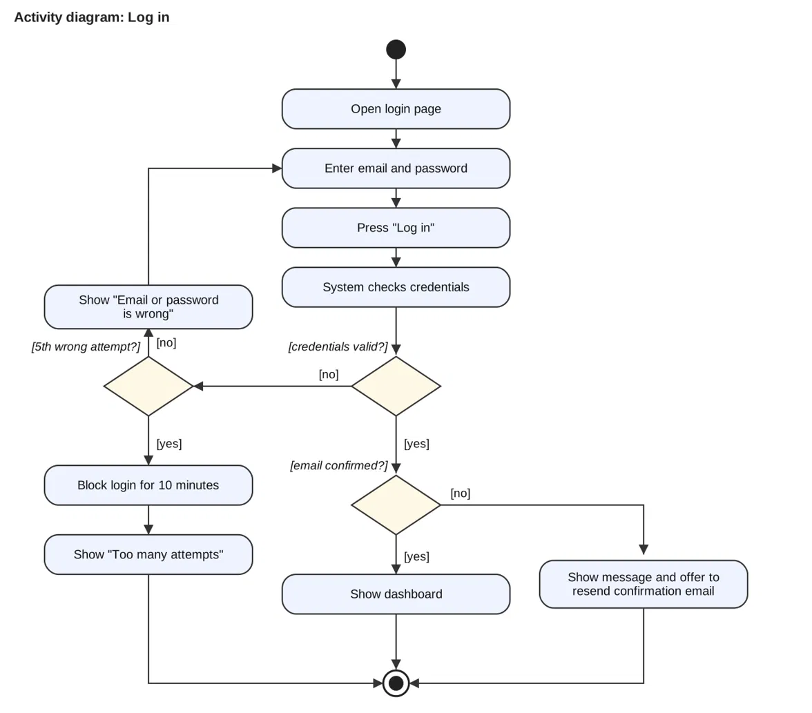
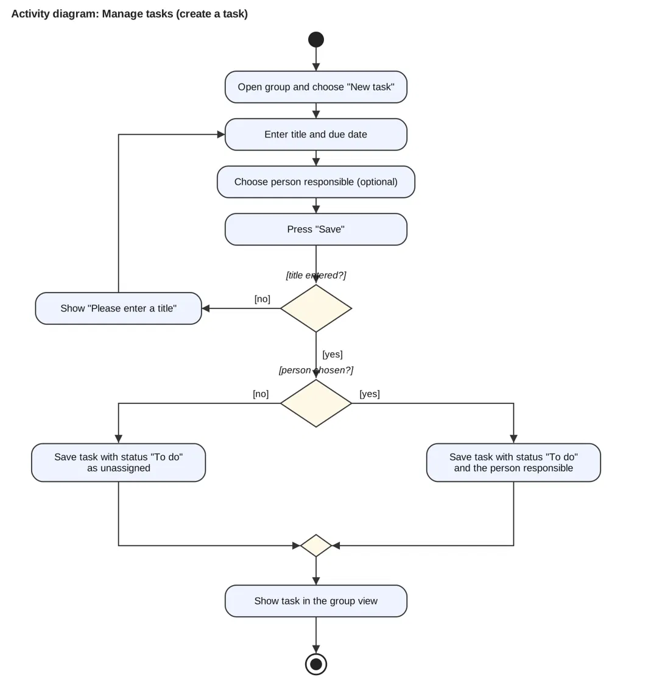

# Week 5: Testing StudyHub with Cucumber

*By Ergens Hyso, Kristine Megrelishvili and Antonio Kanani*

This week we looked at testing. Our StudyHub use cases are now written as **Gherkin feature files** that a computer can run, using **Cucumber**. We wrote two feature files, one for **Log in** and one for **Manage tasks**. Each has several scenarios, and all of them run and pass.

## What is Gherkin and BDD?

**BDD (behaviour-driven development)** means we describe what the software should do in plain language *before* we build it. **Gherkin** is the language for that. Everybody in the team can read it, including people who don't write code, and a tool such as Cucumber can run it as an automated test.

A feature file looks like this:

```
Feature: Log in
  As a Student
  I want to log in to StudyHub with my email and password
  So that I can see my dashboard

  Scenario: Successful login with valid credentials
    Given the email address of "Kristine" is confirmed
    And the student is on the login page
    When the student enters "kristine@example.com" and "Secret123"
    And the student presses "Log in"
    Then the student is redirected to the dashboard
```

| Keyword | Meaning |
| :---- | :---- |
| **Feature** | The use case that is tested, with the actor and the goal |
| **Scenario** | One concrete example of the use case |
| **Given** | The starting situation |
| **When** | What the user does |
| **Then** | What we expect to happen |
| **And** | Adds another step to Given, When or Then |

Each line is connected to a small piece of code, a **step definition**. The sentence is the specification, the step definition is the test, and so the documentation always shows whether the requirement still works. It is living documentation.

## Our two use cases

For each use case we have a screenshot, a narration, an activity diagram and a feature file. The full details are in our [use case specifications](#) *(link to the file in our Git repository)*.

### Log in

The activity diagram shows one happy path and several unhappy paths. Every path has a scenario:



| Path in the activity diagram | Scenario |
| :---- | :---- |
| Valid credentials, confirmed email, dashboard | Successful login with valid credentials |
| Wrong email or password | Login is rejected for wrong credentials (a *Scenario Outline* with 2 examples) |
| Valid credentials, email not confirmed | Login is rejected when the email address is not confirmed |
| Fifth wrong attempt | Login is blocked after five wrong attempts |

### Manage tasks (create a task)



| Path in the activity diagram | Scenario |
| :---- | :---- |
| Title and person entered | Create a task with a person responsible |
| Title entered, nobody chosen | Create a task without a person responsible |
| Title missing | A task without a title is not saved |

```
Scenario: A task without a title is not saved
  When the student enters the due date "2026-11-10"
  And the student presses "Save"
  Then the message "Please enter a title" is shown
  And no task is saved
```

## Running the tests

We use **CucumberJS**. This is the result of `npm test`:

```
8 scenarios (8 passed)
63 steps (63 passed)
```

> *Add screenshot here: the terminal output of the passing tests.* *Add screenshot here: the `.feature` file in our IDE with syntax highlighting.* *Add screenshot here: autocompletion of a step in the IDE.*

StudyHub itself doesn't exist yet, so for now our step definitions test a small in-memory model of the app. Once we have a real interface, we change only the step definitions, not the feature files. The scenarios stay the same.

## How we used AI in this task

We used an AI assistant (Claude) for this task. This is what it did and what we did:

- **AI:** drafted the feature files from our use case specifications, wrote the step definitions and the in-memory model, drew the first version of the activity diagrams, and helped us understand the Gherkin syntax.  
- **We:** decided which use cases and which alternative flows to test, checked that every path in the activity diagram has a scenario, ran the tests ourselves and corrected business rules, such as how many wrong password attempts are allowed.  
- **What we learned:** the AI is fast at producing the first version, but it only tests what we tell it. Some of the rules, such as "block for 10 minutes after 5 wrong attempts", were its suggestions and we had to decide whether we want them. A passing test only means the code does what the scenario says, not that the scenario is right.  
- **Where it helped and where it didn't:** it saved time with the syntax and the repetitive step code. It also drew our diagrams with overlapping labels at first, so we had to look at the result and have it fixed.